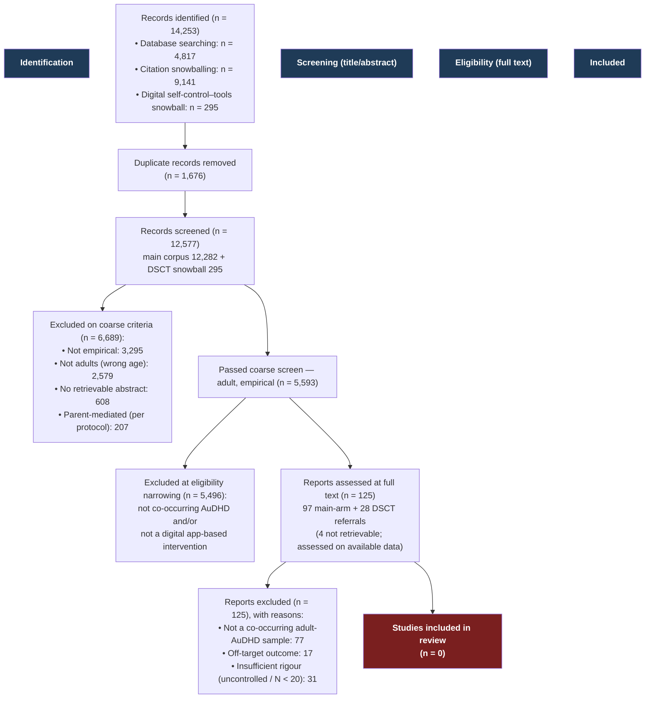

# PRISMA 2020 flow diagram



## Numbers used (reproducible from the pipeline)

| Stage | n |
|---|---|
| Records identified (all sources) | 14,253 |
| — Database searching | 4,817 |
| — Citation snowballing | 9,141 |
| — DSCT snowball (seed doi:10.1145/3571810) | 295 |
| Duplicates removed | 1,676 |
| Records screened (title/abstract) | 12,577 |
| **Excluded at title/abstract screening (coarse criteria) — 6,689** | |
| — Not empirical | 3,295 |
| — Not adults (wrong age) | 2,579 |
| — No retrievable abstract | 608 |
| — Parent-mediated | 207 |
| Passed coarse screen (adult, empirical) | 5,593 |
| Excluded at eligibility narrowing (not co-occurring AuDHD and/or not digital app-based) | 5,496 |
| Full-text reports assessed for eligibility | 125 (97 main-arm + 28 DSCT referred) |
| — not retrievable (assessed on available data) | 4 |
| Full-text excluded — wrong population (not adult AuDHD) | 77 |
| Full-text excluded — off-target outcome | 17 |
| Full-text excluded — insufficient rigour | 31 |
| **Studies included** | **0** |

**Notes.**
- **Two-stage screening.** Screening was performed with a recall-safe, dual-rater AI protocol (Nova 2 Lite + Claude Sonnet 4.6): a record was excluded only when both raters agreed on an explicitly-excluding value; "unspecified" judgments and disagreements were carried forward. A coarse title/abstract gate (empirical, adult, non-parent-mediated, abstract present) excluded 6,689 and passed 5,593; a second abstract-level narrowing to the review population and intervention (co-occurring AuDHD **and** a digital app-based intervention) reduced these to the full-text set. Records excluded at the narrowing stage were single-diagnosis (autism *or* ADHD only) and/or non-digital.
- **Screening-completeness correction.** During revision, 3,146 database-search records were found to carry two-rater classification labels but no recorded screen decision (a pipeline gap in the original run). Their screen decisions were re-derived deterministically from the existing rater labels using the same recall-safe gate; this recovered **19 additional co-occurring-AuDHD digital records** that were then assessed at full text. All 19 were excluded (predominantly wrong population — single-diagnosis or child samples — with the remainder off-target or non-controlled), so the primary result (n = 0) is unchanged. The full-text total is therefore 125 (up from 106).
- Full-text exclusion categories pool the candidate-level decisions in `fulltext_review_master.csv`, the resolved DSCT-snowball referrals (`dsct_resolved.csv`), and the 19 recovered records; the 28 DSCT referrals all failed on population and are counted under "wrong population."
```
